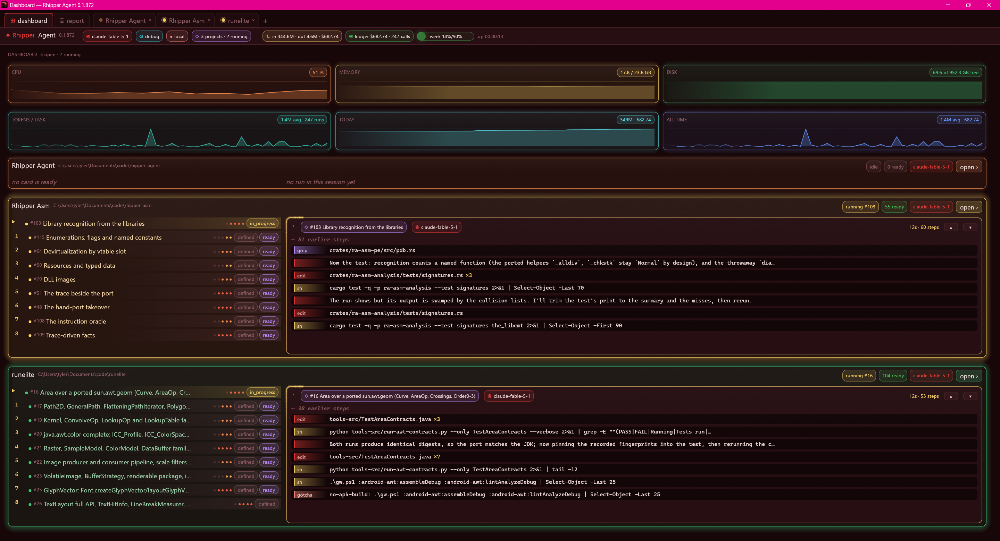

# Rhipper Agent

A roadmap-driven development orchestrator in Rust. A project's work is a roadmap of cards; a
worker (Claude Code headless on the person's plan, or any model through OpenRouter or a local
server) implements one card per run in the project's own directory; the orchestrator does
everything around the run without a model call: the context, the checks, the lint, the
handoff, the ledger, the gotchas. A reviewer judges the result, the person reads verdicts,
and the walk goes on to the next card. One window hosts every project as a tab, and an
external agent session pairs with the whole thing over a one-line-per-event feed.



The roadmap owns the work. Models are replaceable workers. The orchestrator owns coordination,
execution state and acceptance. The agent runs on its own roadmap too: its last eight phases
were planned by itself from the evidence of its own runs.

## The loop

```
rhipper.md  ──rc walk──▶  run a card  ──▶  check  ──▶  lint  ──▶  review  ──▶  accept / send back
    ▲                        │ handoff, ledger, gotchas, look-backs            │
    └── rc plan (from the runs' own evidence) ◀────────────────────────────────┘
```

1. **A card** has an objective, acceptance criteria (every backticked command in it is a
   check), the files the change lands in, a complexity, and what it waits on.
2. **A run** sends the worker the card, the project context, an outline of each file it names
   (regions, not whole files), the last handoffs, and the machine notes. The worker acts in the
   project directory with its own tools; the shell allowlist and the gotcha hooks hold it.
3. **The check** runs after the worker returns, in the foreground: the acceptance's commands in
   order, else the project's default, else the workspace tests. Then **the lint** over the files
   the run changed. A lint-only failure takes a cheap fix pass, not a second full run.
4. **The reviewer** reads the acceptance, the handoff and the diff of the card's files, and
   answers `accepted` or `needs revision` with points. Points land at the head of the card's
   notes; a rerun resumes the same session with the verdict as its new prompt.
5. **The person** reads verdicts, not diffs: accepts, commits, re-queues. The pair feed and the
   dashboard tell them when.

Everything the orchestrator does between the model calls is local and free: the context is
built from the files, the handoff from the diff, the gotchas from regular expressions, the
ledger from the stream's own usage events.

## The pieces

### The roadmap

`rhipper.md` beside the code: project → milestones (phases) → sections → cards (tasks and
subtasks). A card's states: `defined` → `in_progress` → `implemented` → `review` → `accepted`,
with `needs_revision`, `failed`, `blocked`, `cancelled` at the side. A card is *ready* when it
is defined and nothing it waits on is open. `rc show`, `rc show <id>`, `rc next --why`,
`rc check` (the lint of the roadmap itself), `rc add`, `rc edit`, `rc depend`, `rc move`,
`rc remove`, `rc import` (a Markdown outline), `rc init` (a strong model drafts the roadmap
from what the directory shows). The console and the window follow outside edits of the file.

### Gambits: the standing direction

A gambit is a sentence of direction with a weight and focus words. The walk orders the ready
cards by the person's priority first, then by the summed weight of the active gambits whose
focus matches the card's title, milestone or files, then by the file's order. Park a gambit
and the cards it pulled sink; add one and the queue reorders itself.

```
rc gambit add "The goal is the PE port, 32 to 64 and 64 to 64 …" --weight 5 --focus emit output port x86 x64 …
rc gambit park 6
rc priority 47 5
rc next --why          # each ready card with the gambits that scored it
```

A gambit with `plan-next: true` asks the walk to plan an empty milestone when nothing is ready.

### The walk

`rc walk` runs every ready card in order, as a process of its own that the window starts and
the tab shows: detached, hours long, surviving window restarts and a session's tool limits.
`rc walk --stop` ends it after its current card. A walk keeps the rc it started with; after an
install that matters, stop it and start it again between cards. One job per project.

### Workers and routes

The model id decides the route. A bare `claude-*` id runs on the local Claude Code
(`claude -p`, stream-json, the machine's own login), so a subscription pays. A `vendor/model`
id goes through OpenRouter; `local/<name>` to an OpenAI-compatible server at
`RHIPPER_LOCAL_URL`. A bare model on those routes gets the `ra-tools` toolbox and the tool
loop. `[[route]]` rules in `rhipper.toml` pick a model by complexity and kind; a card can name
its own (`--model`); `rc route <id>` says which and why. The cheap roles a run ends with (the
handoff summary, the digest line, the look-back classifier) go to the `[role]` table's models,
else to the local server when it answers a ping, else to no call at all.

Every run of a card resumes the harness session of the last one, reruns included: the cache
holds the context the worker read the code in. There is no turn cap by default. A project may
set `[worker] context = 160000`: once a turn's input passes it (after the first twelve turns,
which a fresh session spends reading in), the run ends on a handoff and the card continues in
a fresh session. A turn's cost scales with the context it carries, so this is the lever, not
turn counts.

### Checks, lint and the reviewer

The check is what the card's acceptance names in backticks, in order, stopping at the first
failure; the project's `[worker] check` when it names none; `cargo test --workspace -q` when
neither does. `[worker] check_timeout` gives a long suite its half hour. The lint is clippy
over the changed crates, or the project's `[worker] lint`, or none (`lint = ""`). A failed
check leads the notes and the handoff with its output. The reviewer's diff covers the card's
files, the files the handoff names and the untracked files among them, so a worker's work is
never judged unseen. `rc review <id>` runs the reviewer by hand.

### Context and handoffs

`rhipper.context.md` is the project context every run carries: layout, build and checks,
conventions, the standing direction. `rc context --init` drafts it; it is kept by hand.
`var/context/<id>.md` is a card's context: the brief, the outlines, one handoff per run (the
outcome, the check, the verdict, the files changed, what was done and what is left). A
continued card opens on what the last session left; a sent-back card opens on the review.
`rc context <id>` prints what a run would send; `rc run <id> --dry` the whole prompt and the
harness command line.

### Gotchas: a gotcha is anything standing in the way

A `[[gotcha]]` in `var/gotchas.toml` (seeded from `crates/ra-gotchas/gotchas.toml`, the seed
merged in on every run start) is a regular expression over a command, a result, an edit or a
text, with a remedy: a hint that denies with a message, a rewrite of the command, or a count.
Claude Code's tool hooks call `rc hook pre|post`, which refuses or rewrites before the command
runs and adds the hint a result calls for; the stream reader counts what the run hit anyway.
Every refused command counts. `rc gotchas` shows the counts and the refused commands no gotcha
names yet; the machine notes of the next run name what the last runs hit. No model call.

### Notes and look-backs

A line typed in the window without `/`, or `rc note "…"`, is a note the next runs read: what
slowed one, a quirk of the machine, a direction ("no APK builds here"). Notes live in
`var/retro.log` with the workers' own look-backs, and the latest ride in the next runs'
prompts. The other projects' digests ride too, one line each, so a worker knows what else is
touching the machine.

### Debug mode

Debug mode is the agent asking every run what would have made it faster. It is on by default
(the `⚙ debug` badge in the status bar; click it to turn it off everywhere, `RHIPPER_DEBUG=off`
or `rc run --no-debug` for one run). With it on, the worker's system prompt ends with one more
instruction: close the report with a section `## Faster next time` of at most three one-line
bullets, each naming what cost the run turns or time (a refused command, a file it had to
search for, a check run twice, a quirk of the machine) and the one change that would have
avoided it, a bullet starting with `[machine]` when the cause is this machine rather than the
task. Nothing else goes in that section, and it is left out when nothing cost anything.

The orchestrator parses the section out of the report, keeps the bullets in `var/retro.log`
stamped with the card and the run, shows them as `↯` lines under the run in the window, and
puts the latest five into the next runs' machine notes, so the next worker does not find out
the hard way again. A cheap local role classifies an untagged bullet as `[machine]` or not. A
bullet that names a project fact belongs in `rhipper.context.md`; a recurring machine problem
becomes a gotcha; a cost pattern becomes a card through `rc plan`, which reads the same log as
evidence. The cost of debug mode is a few dozen output tokens a run; what it buys is the
system's memory of its own friction.

### Evidence planning

`rc plan` plans the next cards from the runs' own records: the ledger's costliest cards, the
cards run more than once, the look-backs, the gotcha journal and the other projects' digests.
Each card cites its evidence and names a saving and a check; the next day's walk reads the
saving back into `var/retro.log`. An empty milestone plus the plan-next gambit makes the walk
plan it. `rc plan <id>` asks the architect model to split a milestone into cards and adds them
on confirmation.

### The ledger and the plan's room

`var/usage.db` records every call: model, role, card, turns, tokens, cached tokens, cost.
`rc usage` prints the plan's windows first, then the ledger by model; `rc status` the
project's line (the live run, the ready count, today's calls, the last end). The provider
keeps the plan's `rate_limit_event` in `var/limits.json`; the status bar's week pill shows it.

### The window

`rc-gui`, egui, the Blood Moon theme. One window on the machine, Chrome-style tabs: the
**dashboard** (machine gauges; tokens per task, today, all time; one card per project with its
queue and its live run side by side, growing into the window's spare height), the **report**
(what landed, by time or by project), and a tab per project (the roadmap as nested bubbles,
the card / context / ledger views, the console with one bubble per answer and run cards whose
steps pin to the bottom while live). Tabs are remembered across sessions. `rc open <dir>`
hands a project to the running window or starts it; `rc restart` brings the window back on a
new build with the same tabs; `rc stop` closes one project's tab.

### The pair feed: an external agent on every project

`var/pair.log` is one line per event: `start #id …`, `end ✓|✗|↻ #id … · cost · the cap or
the check`, `review ✓|✗ #id …`, `walk ran N card(s) · why it stopped`, `note …`, `window
up|down`. `rc pair --follow --since <ts>` follows it. A pairing session (Claude Code in a
terminal, say) watches the feeds of every project, reviews what lands, accepts, commits,
re-queues, adds cards and gambits, and leaves notes. The repository's `rhipper-pair` skill is
its playbook.

## A project's configuration

`rhipper.toml` beside `rhipper.md`:

```toml
[worker]
allow = ["clang", "ras.exe", "Bash(ninja *)"]   # commands beyond the agent's own allowlist
check = ".\\gw.ps1 :android-awt:compileDebugJavaWithJavac"   # the default check of a card that names none
lint = ""                 # no lint; a command runs it instead of clippy; absent, clippy over the changed crates
check_timeout = 1800      # seconds a check may run; 1200 without it
context = 160000          # a run restarts fresh once a turn carries this many tokens; absent, no cap
[worker.env]
CARGO_BUILD_JOBS = "6"

[role]                    # the cheap roles: summary, digest, classify
summary = "local/qwen"    # absent: the local server when it answers, else no call

[[route]]                 # the model by complexity and kind
complexity = [4, 5]
model = "claude-opus-5-5"

[plan]
threshold = 3             # how much evidence a planned card needs
```

## Day to day

```powershell
rc init                      # or rc import plan.md: a roadmap from what is there
rc open .                    # the project as a tab of the one window
rc gambit add "…" --weight 5 --focus …
rc walk                      # the walk runs the ready cards in order; rc walk --stop ends it after the current one
rc pair --follow             # or a pairing session's Monitor on var/pair.log
rc show 47                   # the verdict and the notes; rc set 47 accepted, or rc set 47 defined to re-queue
rc note "the oracle suite needs half an hour here"
rc plan                      # the next cards, from the evidence
rc install; rc restart       # a new build of the agent itself; the window comes back on its tabs
```

Several projects at once: open each as a tab, walk each with one job, watch one feed over all
of them. The dashboard shows every project's queue and live run on one page.

## Why it works

- **The roadmap owns the work, not the conversation.** A card is the unit of context, of
  cost, of review and of memory. Nothing depends on a chat transcript surviving.
- **Everything around the model is local and free.** Context, outlines, checks, lint, diffs,
  handoffs, gotchas, the ledger: no tokens. The model is spent on the change itself.
- **The system learns from its own records.** Look-backs, gotchas, costs and reruns feed the
  next prompts and the next plan; the agent's own phases N through R were planned that way.
- **Verdicts, not diffs.** The reviewer reads the diff; the person reads one line per card and
  decides. The git log is the review record.
- **Direction without micromanagement.** Gambits and priorities steer a queue of dozens of
  cards across projects; parking one reorders the week.
- **Economics by construction.** Sessions resume so the cache holds the context; the context
  cap, not a turn count, bounds what a turn costs; cheap roles run locally.
- **It runs itself.** The agent's roadmap is a project like the others; a pairing session adds
  a card when a serious saving shows up in a run or a review, and the walk implements it.

## Crates

| Crate | Responsibility |
|---|---|
| `ra-roadmap` | Projects, milestones, sections, cards, dependencies, states, gambits, priorities; the `rhipper.md` store; the tree walks and the ranking |
| `ra-providers` | The `ModelProvider` trait; the Claude Code adapter (stream-json, the context watch, the gotcha hooks), the OpenRouter adapter and the local route; the plan's limits |
| `ra-tools` | The tools a bare model gets to act in a workspace: files, search, an allowlist of commands; the check runner |
| `ra-usage` | The usage ledger: tokens and cost per call, model, role and card |
| `ra-gotchas` | The catalogue of recurring machine problems, the hooks that act on them, the journal |
| `ra-context` | The project context every run carries, a card's context and handoffs, the review block |
| `ra-console` | The worker that runs a card, the checks and the lint, the reviewer and the fix pass, the planner, the walk, the hub (window lock, mailbox, digests), the pair feed, the commands, the MCP server, the terminal console |
| `rc` (app) | The CLI, every command above |
| `rc-gui` (app) | The window: the strip, the dashboard, the report, the roadmap column, the card view, the console |

## Build and install

```powershell
cargo build -p rc -p rc-gui
.\target\debug\rc.exe install     # copies rc and rc-gui to %LOCALAPPDATA%\Programs\rhipper, on the PATH
rc restart                        # the window on the new build, same tabs
cargo test --workspace -q
```

`rc doctor` checks what a run needs: `claude` on the path and logged in, the hooks, the settings
a worker loads, git, the local server, the OpenRouter key, the roadmap, the ledger. The MCP
server (`rc mcp`, `.mcp.json`) serves the roadmap and the workers to a Claude Code session;
the workers themselves run with `--strict-mcp-config`.
